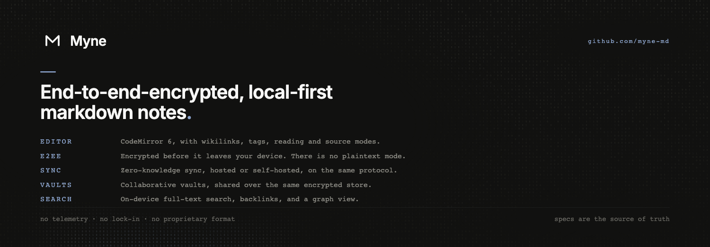

# Myne

> You write. No one else reads. Sync is a server you run.

End-to-end-encrypted, local-first markdown notes.

- **Encrypted, no opt-out.** Note content, titles, folder structure, timestamps and attachments stay encrypted at rest and in transit. There is no plaintext mode for your vault.
- **Plain markdown after decryption.** No proprietary block format. If Myne disappears, your files are already in a format every editor understands.
- **Same protocol whether you run the server or someone else does.** Sync is optional and zero-knowledge; self-hosting changes the operator, not the security model.

**Pre-alpha.** Tagged releases are published at [downloads.myne.md](https://downloads.myne.md). The on-disk format is still pre-1.0.

→ [myne.md](https://myne.md)
